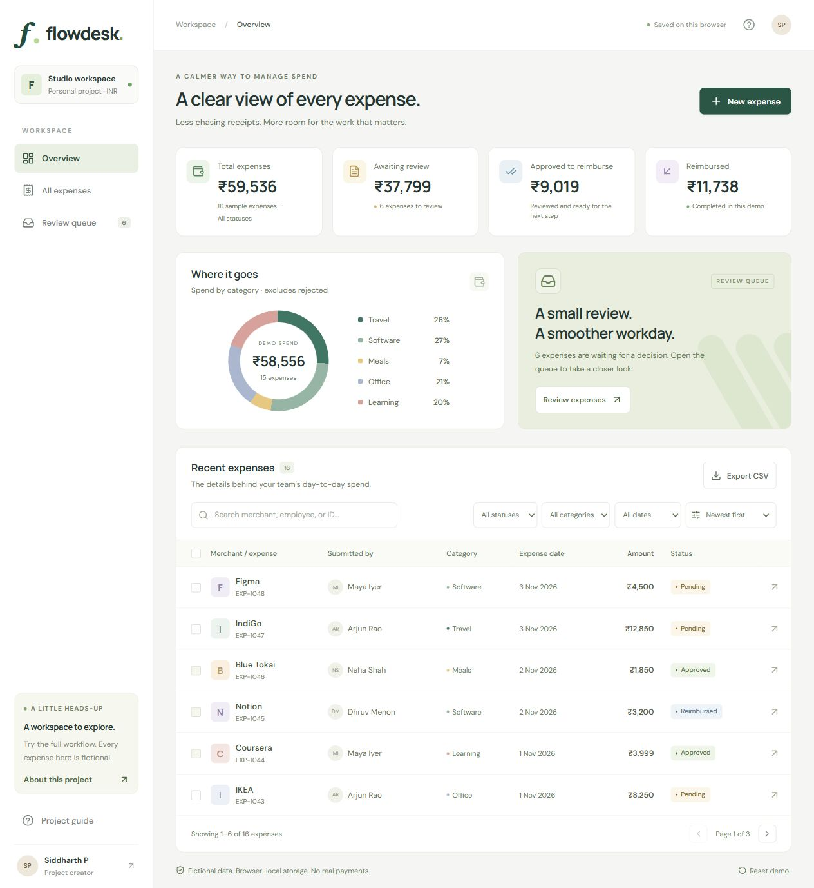

# Siddharth P — Engineering Showcase

**Senior Software Engineer · Enterprise UI and JavaScript Frameworks**  
JavaScript · jQuery · Syncfusion · HTML5 · CSS3 · Playwright

I build shared UI framework capabilities at Odessa Technologies, with 4+ years of experience across configuration-driven components, enterprise grids, navigation, component-library upgrades and release validation. This repository brings together my portfolio, an independent React project and high-level professional case studies.

[Portfolio website](https://siddharthprabu10901.github.io/siddharth-showcase/) · [Flowdesk demo](https://siddharthprabu10901.github.io/siddharth-showcase/flowdesk/) · [LinkedIn](https://www.linkedin.com/in/siddharth-p-07a967217)

## Selected work

| Work | What to review | Source / case study |
| --- | --- | --- |
| **Flowdesk** | Expense creation, validation, search, filtering, approval/rejection, bulk review, activity history and CSV export | [Application source](apps/flowdesk) · [Architecture](docs/architecture.md) |
| **Portfolio** | Professional background, project walkthroughs, responsive layout and contact details | [Application source](apps/portfolio) |
| **Enterprise UI at Odessa** | Configuration-driven card layouts, safe navigation, conditional grid actions, regional formatting and the Syncfusion upgrade | [Professional case studies](docs/professional-case-studies.md) |

React and TypeScript are **personal project skills**. My professional frontend experience centres on JavaScript, jQuery and Syncfusion. Supporting work includes ASP.NET MVC requirements, basic C# changes and SQL for UI needs; Web API knowledge is basic.

## Professional delivery highlights

- Breadcrumb navigation delivered across four stories and seven pull requests.
- Syncfusion 25.1.39 to 29.2.10 upgrade: seventeen days from analysis to merge, followed by targeted validation.
- Monetary formatting rules defined for ten regions; documented QA covers Indian, Western and European cases.
- Four documentation pages published and contributions to nine shared pages.

[Read the five professional case studies](docs/professional-case-studies.md). These are production JavaScript/jQuery contributions; React and TypeScript remain personal-project skills.

## Flowdesk highlights

- Validated create/edit forms, including dates and amounts with paise.
- Search, combined filters, numerical sorting and pagination.
- Explicit approval/rejection transitions, activity history and bulk approval.
- Browser-local persistence with validation of saved records and visible recovery messages.
- Filtered CSV export with escaping and spreadsheet-formula text handling.
- Responsive tables, keyboard-operable dialogs and focus restoration.
- Unit tests for business rules and desktop/mobile Playwright scenarios.

The records are fictional. Flowdesk is a frontend demonstration with no shared backend, authentication, receipt uploads or payment processing.



## Technology

React, TypeScript, CSS, Vite, Lucide icons, browser localStorage, Vitest, Playwright, npm workspaces and GitHub Pages. Both apps are function-component React applications.

## Run locally

Node.js 24+ and npm:

```sh
npm ci
npm run dev             # portfolio
npm run dev:flowdesk    # expense workspace, in a second terminal
npm test
npx playwright install chromium
npm run test:e2e
npm run build
npm run preview         # combined production build
```

Each dev command prints its local address. The combined build output is `dist/`, with the portfolio at the root and Flowdesk under `flowdesk/`. Both apps use the `/siddharth-showcase/` GitHub Pages prefix; update their Vite base paths if you rename the repository.

## Repository layout

```text
apps/portfolio/                 Portfolio and printable résumé
apps/flowdesk/                  Expense workspace, domain rules and tests
docs/professional-case-studies.md
docs/architecture.md
scripts/assemble-site.mjs       Combines the two static builds
```

## Professional work and development context

The Odessa case studies are summaries of my contributions. They contain no employer source code, internal screenshots or customer data. The independent applications were developed with AI assistance. See [development notes](CREDITS.md) for scope and attribution.

Tutorials and rebuild exercises are maintained separately in [Flowdesk's educational repository](https://github.com/siddharthprabu10901/flowdesk) and the [portfolio educational repository](https://github.com/siddharthprabu10901/siddharth-portfolio).

## Contact

[LinkedIn](https://www.linkedin.com/in/siddharth-p-07a967217) · [GitHub](https://github.com/siddharthprabu10901) · siddharthprabu10901@gmail.com  
Based in Coimbatore; open to opportunities in Tamil Nadu and Bengaluru.
